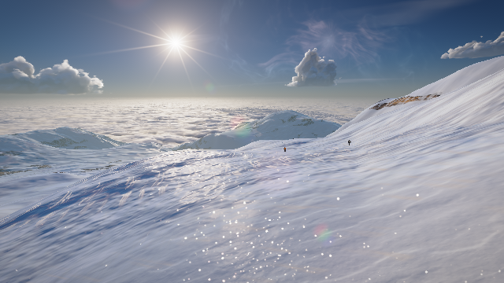
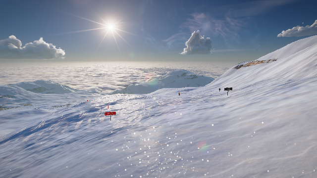

# La Balme piste network

Open the Alpe d’Huez piste network from the title screen or append
`?reality=alpe-dhuez&network=1`. It starts on the incoming section of
Déversoir, about 65 m along the mapped line before the fork. The original
`?reality=alpe-dhuez` still starts on La Balme in single-piste mode.

## Survey and data sources

The retained OSM snapshot is dated **2026-11-18 18:17:25 UTC**. The survey
checked 208 downhill ways from Overpass within the WGS84 bounding box
45.085° N, 6.065° E to 45.120° N, 6.115° E. Exact line intersections and
shared node IDs agree on the two direct neighbours below. Proximity
alone is insufficient for an edge. For example, the other way named
Déversoir (1219562168) comes within 145 m of La Balme and does not
intersect it. Combe Charbonnière (150810517) is approximately 170 m
away at its closest. Neither adds a direct connection. The source extracts are
[La Balme](../../data/reality/la-balme.osm.json) and
[neighbouring ways](../../data/reality/la-balme-neighbours.osm.json).
These contain © OpenStreetMap contributors data under the ODbL 1.0.

| OSM node | Latitude, longitude | Lambert-93 E, N (m) | Downhill choices |
|---|---|---|---|
| [251693664](https://www.openstreetmap.org/node/251693664) | 45.1050884, 6.1019936 | 943913.90, 6449882.07 | Incoming Déversoir [256295592](https://www.openstreetmap.org/way/256295592) can continue left on Déversoir (red) or turn right onto La Balme [23257919](https://www.openstreetmap.org/way/23257919) (black) |
| [253678404](https://www.openstreetmap.org/node/253678404) | 45.0915731, 6.0899313 | 943024.63, 6448345.00 | La Balme joins Campanules [23257916](https://www.openstreetmap.org/way/23257916) (red), left from the La Balme approach. Incoming Campanules joins the same downhill continuation |

A junction requires the same OSM node ID and exact source coordinates.
The importer orders each way downhill from its endpoint elevations.
An approach or exit must have at least 12 m of mapped line and at least
0.5 m of signed elevation change measured up to 25 m from the node.
The left/straight/right arrows compare the incoming 22 m chord with
the outgoing 24 m chord, using ±0.26 radians for straight ahead.
This validates mapped topological and downhill continuity. It does
not indicate current snow, opening or avalanche conditions.

## Terrain and navigation

The three ways share the existing `grid`: IGN RGE ALTI, 628 × 728
at 15 m in EPSG:2154, the same 6.025–6.150° E and 45.050–45.145° N
coverage and 20 m interior border as the original release. No DEM data,
license, acquisition cost or area was added. The original numbers on La
Balme are unchanged. Red stakes mark the two other pistes. Direction
panels are approximately 22 m up the incoming line and 18 m to its
side, using the destination's difficulty tint for the face and support.
The panel rear omits the arrow. Crossing the former La Balme end on
Campanules continues on the same surface. The network run restarts
when the player leaves the DEM interior or skis 68 m from every
surveyed line.

The graph and marker positions are prepared once. A 96 m cell index
limits distance queries to local candidate segments. New decorations
use a 768 × 80 RGBA atlas and a shared vertex buffer. The camera's
192 m longitudinal band and its neighbours are submitted as at most
one draw, with a lateral bounds check. The
original mode instantiates neither the network nor its decoration
pipeline, and there is still only one height array and terrain clipmap.

To reproduce the graph from the retained extracts:

```sh
/usr/bin/python3 -B tools/reality/network.py \
  --asset data/reality/alpe-dhuez.json \
  --osm data/reality/la-balme.osm.json data/reality/la-balme-neighbours.osm.json \
  --out /tmp/alpe-dhuez-network.json
cmp /tmp/alpe-dhuez-network.json data/reality/alpe-dhuez.json
```

## In-game captures

The two overview frames use the same saved camera, DEM, 640 × 360
viewport, clear weather, day lighting and WebGL2. Camera settings are
in [views.json](views.json). The close-ups show each destination and
its approach-facing arrow.

| Baseline fork | Network fork |
|---|---|
|  |  |

[Déversoir close-up](deversoir.png) · [La Balme close-up](la-balme.png) ·
[Campanules close-up](campanules.png)

## Performance protocol

Baseline commit `facbe88d08c2ab42574963682b596d296bcdb0b9`. Run the
baseline and network samples serially on the same runner:

```sh
baseline=$(mktemp -d)
git archive facbe88d08c2ab42574963682b596d296bcdb0b9 | tar -x -C "$baseline"
(cd "$baseline" && npm run build)
npm run build
node docs/reality-network/benchmark.mjs "$baseline/dist/dev.html" \
  "$baseline/dist/reality/alpe-dhuez.json" /tmp/piste-before.json baseline
node docs/reality-network/benchmark.mjs dist/dev.html \
  dist/reality/alpe-dhuez.json /tmp/piste-after.json network
```

Chromium 156 / ANGLE SwiftShader, Xeon Platinum 8573C, 320 × 180,
quality 2, governor off, clear weather, fixed daylight, no motion
blur. Both runs initialize from the same La Balme spawn and step the
same `pilot(0.45, 5.2)` 120 times at 1/60 s. The two fixed camera
targets are centred at 20 m and 1,741.78 m on the original
La Balme axis. Each camera discards three warm-up frames
and records four rendered frames with a one-pixel synchronous
WebGL readback. The FPS equivalent is 1,000 divided by the median
completed-frame time. Software rendering and forced readback make
the absolute values unsuitable as player FPS on hardware.

Load time covers boot and the held pipeline release, and
navigation-to-ready also includes document load. Each configuration
records a cold browser sample. The memory figures are used JS heap
after explicit garbage collection and estimated bytes requested from
graphics texture and typed-array buffer constructors during the run.
The graphics estimate does not track deallocation or driver overhead,
and the two counters do not represent browser RSS. Draw calls and
triangles count draw submissions across all passes.

| Metric | Base | Network | Change |
|---|---:|---:|---:|
| Boot + held pipelines | 13.497 s | 12.725 s | −0.771 s |
| Navigation to ready | 14.426 s | 13.046 s | −1.380 s |
| Upper camera median frame / FPS equivalent | 567.4 ms / 1.762 | 716.0 ms / 1.397 | **−20.8% FPS** |
| Lower camera median frame / FPS equivalent | 518.1 ms / 1.930 | 546.2 ms / 1.831 | **−5.1% FPS** |
| Upper camera draw calls / submitted triangles | 60 / 356,393 | 61 / 356,561 | +1 / +168 |
| Lower camera draw calls / submitted triangles | 54 / 331,741 | 55 / 332,077 | +1 / +336 |
| Used JS heap after GC | 9.05 MB | 13.09 MB | +4.04 MB |
| Tracked graphics allocations | 265.24 MB | 265.59 MB | +0.34 MB |

[Baseline samples](baseline-final.json) · [Network samples](network-final.json).
The one cold sample showed no loading increase. The two measured
memory counters grew by about 4.39 MB in total. The cross-launch
software FPS measurements exceed the 5% regression target at both
cameras. The decoration draws have already been packed into a
single visible range. Hardware FPS and multi-launch cold-start
confidence remain open.

### Same-browser diagnostic

In an additional network boot, the harness alternated submitting or
suppressing only the new decoration draw in paired sequences
(visible, hidden, hidden, visible). The upper medians were 689.0 ms
visible and 762.8 ms hidden. Lower medians were 642.0 ms visible and
651.1 ms hidden. The spread is large and this does not show a
consistent decoration penalty. It does not clear the cross-launch FPS
regression or establish its cause. Hardware GPU and a larger set of
cold and steady runs are needed for performance acceptance.
[Diagnostic samples](ablation.json).

## Verification

- `npm run check` passed, including the web and native script checks.
- `npm test` passed all six tests, including the shared-node graph,
  direction arrows, difficulty colours and numbered La Balme signs.
- The GDAL importer test passed and the retained OSM extracts
  reproduced the checked-in network JSON byte for byte.
- `npm run test:browser -- --release` passed in
  [GitHub Actions](https://github.com/lzcjames/cold-smoke-reality/actions/runs/44406516276).
  The suite exercised the procedural mountain, La Balme single-piste
  mode and the network on WebGL2 and WebGPU. It checked uphill
  network spawn, real drawing, ground contact, continuity past the
  La Balme endpoint and restart outside the DEM.
